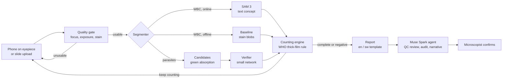

<div align="center">

# Darubini

**A malaria microscopy copilot built on Meta SAM 3 and Muse Spark.**
A phone on a microscope eyepiece, a count a microscopist can trust, a report in Kiswahili or English.

[](https://github.com/albertmwangwa/darubini/actions/workflows/ci.yml)
[](https://github.com/albertmwangwa/darubini/actions/workflows/codeql.yml)


*Darubini is Kiswahili for a magnifying scope. Built for the Meta Global AI Developer Hackathon 2026, Indie track.*

</div>

> [!IMPORTANT]
> Darubini is **decision support for trained laboratory staff, not a diagnostic device.** Every result must be confirmed by a qualified microscopist. It has not been clinically validated.

---

## Contents

- [Why this matters](#why-this-matters)
- [What Darubini does](#what-darubini-does)
- [How it uses Meta AI](#how-it-uses-meta-ai)
- [Architecture](#architecture)
- [Quick start](#quick-start)
- [Datasets](#datasets)
- [Evaluation plan](#evaluation-plan)
- [Engineering and quality](#engineering-and-quality)
- [Project layout](#project-layout)
- [Roadmap](#roadmap)
- [Responsible AI](#responsible-ai)
- [Acknowledgements and citations](#acknowledgements-and-citations)

## Why this matters

- WHO estimates **282 million malaria cases and 610,000 deaths in 2024**, with 11 African countries accounting for about two-thirds of both ([World Malaria Report 2025](https://www.who.int/teams/global-malaria-programme/reports/world-malaria-report-2025)).
- **Tanzania ranks fourth worldwide for malaria deaths, with 4.3% of the global total in 2024** ([The Citizen, citing the World Malaria Report 2025](https://www.thecitizen.co.tz/tanzania/news/national/tanzania-among-four-countries-with-highest-malaria-deaths-globally-5433286)).
- Light microscopy of Giemsa-stained thick blood films remains the reference method for confirming malaria and measuring **parasite density**, which guides severity assessment and treatment follow-up. Counting is slow, tiring and depends on scarce, well-trained microscopists. Quality varies with fatigue, stain and smear thickness.

Darubini keeps the microscopist in charge and takes the tedious counting off their hands.

## What Darubini does

1. **Capture.** A phone held to the eyepiece photographs one microscope field at a time, or records a short clip while the technician pans the slide (or a slide image is uploaded).
2. **Quality gate.** Fast checks for focus, exposure and staining reject unusable fields and ask for another, as a careful technician would.
3. **Segment.** SAM 3 finds the white blood cells (WBC) from a text concept prompt. Parasites start as high-recall candidates (spots that absorb green light, as Giemsa-stained chromatin does), and a small verifier network keeps the real ones.
4. **Count.** Parasites are counted against WBC and converted to **parasites per microlitre** using the procedure taught in WHO *Basic Malaria Microscopy*: count against 200 WBC, extend to 500 WBC when few parasites are seen, and declare a slide negative only after enough clean fields. Every threshold is configurable.
5. **Agent, audit and report.** A Muse Spark agent runs the count through deterministic tools: it chooses how many fields to examine at a time, asks a vision second reader about doubtful fields, excludes unusable ones with a reason, and audits a random sample of its own parasite detections before it may finish. It then writes the narrative in **Kiswahili or English**. The model never sets a number: a narrative quoting a number the tools did not return is dropped.
6. **Count once on video.** SAM 3.1 tracks each detected parasite and WBC through a panning clip, so an object seen in many frames is counted once.
7. **Hand back.** Excluded fields and audit warnings are listed for the microscopist to confirm.

```text
Fields examined: 14 (13 usable)
Parasites counted: 31
White blood cells counted: 206
Estimated density: 1,204 parasites/µL
Status: Count complete

Decision-support estimate only. A qualified microscopist must confirm this result before any clinical use.
```

<sub>Example output format with illustrative numbers. Real evaluation results will appear in [docs/EVALUATION.md](docs/EVALUATION.md).</sub>

## How it uses Meta AI

| Meta tool | Role in Darubini | Beyond a basic call |
| --- | --- | --- |
| **SAM 3** (promptable concept segmentation) | Finds WBC from a text concept (F1 0.95 on NIH validation fields); tracks objects through video | Box prompts on keyframe detections, followed through an MP4 clip, so each parasite and WBC is counted once while the slide pans (`darubini track`); prompt wording and tiling tuned by a cached, cost-guarded sweep |
| **Muse Spark** (multimodal reasoning) | Tool-calling counting agent; field quality second reader; parasite audit; bilingual narrative | Runs a whole slide unattended through five tools under guardrails (`darubini agent`); audits a random montage of 20 detections and flags slides where the count is probably inflated by platelets or debris |
| **Meta open-weights models** (via partner inference) | Offline Kiswahili report drafting | Path to a low-connectivity clinic deployment |
| **Muse Code** | Pair-programming during the build | Generates test scaffolds and evaluation scripts |

Glimmer and any other tools announced at kickoff will be assessed on day 1 and added here if they fit.

All Meta Model API calls sit behind one adapter, [`src/darubini/meta/client.py`](src/darubini/meta/client.py), wired to `https://api.meta.ai/v1`: SAM 3.1 through the Responses API, Muse Spark through Chat Completions. SAM replies are cached on disk, so an image and prompt are never billed twice.

## Architecture



| Module | Responsibility |
| --- | --- |
| `darubini.quality` | Laplacian-variance focus (at a fixed 1,024 px scale), exposure and Giemsa stain-fraction checks; `darubini.calibration` sets the focus floor from real fields |
| `darubini.segmentation` | `Segmenter` protocol and factory (`baseline`, `verified`, `sam3`, `hybrid`); `BaselineSegmenter`, `CandidateDetector` (green-absorption parasite candidates) and `SamSegmenter` (SAM 3, tiled) |
| `darubini.verifier` | Parasite verifier: a small NumPy network that keeps real parasites among candidates; weights in `.npz`, no pickle |
| `darubini.counting` | Parasite density, configurable WHO-style stopping rule, slide status |
| `darubini.report` | Deterministic English and Kiswahili reports (the source of truth for numbers) |
| `darubini.meta` | Meta Model API client (SAM 3.1 images and video, Muse Spark chat and tool calls) and the Muse Spark reviewer |
| `darubini.agent`, `darubini.audit` | Muse Spark counting agent with guardrails; second-reader audit of parasite detections |
| `darubini.tracking`, `darubini.video` | Count each object once across a panning clip (SAM 3.1 video or offline shift tracker); MP4 encode/decode with PyAV |
| `darubini.data` | Dataset manifest, resumable checksum-verified downloads, annotation parsers |
| `darubini.evaluation` | Detection precision/recall/F1 (centre or IoU matching), count MAE and bias, slide sensitivity/specificity |
| `darubini.benchmark`, `darubini.sweep` | Score whole segmenters on labelled splits; SAM prompt and tiling sweeps with a cost guard |
| `darubini.api` | FastAPI service (`POST /v1/analyse`, `GET /health`, OpenAPI docs at `/docs`) |
| `darubini.cli` | `darubini datasets`, `download`, `verify`, `links`, `calibrate`, `sweep`, `train-verifier`, `evaluate`, `analyse`, `agent`, `track`, `serve` |

## Quick start

Requires Python 3.10+ and `make`.

```bash
git clone https://github.com/albertmwangwa/darubini.git
cd darubini
make setup          # venv, dev dependencies, pre-commit hooks
make check          # lint, types, security, tests: everything CI runs
```

On **Windows**, the quickest route is to download [`scripts/setup-darubini.cmd`](scripts/setup-darubini.cmd) into the folder you want (for example `F:\Projects`) and double-click it: it clones the repo, installs everything and downloads the core datasets. Or step by step (no `make` needed):

```powershell
git clone https://github.com/albertmwangwa/darubini.git
cd darubini
powershell -ExecutionPolicy Bypass -File scripts\setup.ps1
powershell -ExecutionPolicy Bypass -File scripts\get-data.ps1        # core datasets
```

Try it offline with the baseline segmenter (no API key needed):

```bash
.venv/bin/darubini analyse path/to/field1.jpg path/to/field2.jpg --language sw
make serve          # phone app on http://127.0.0.1:8000, API docs at /docs
```

With Meta Model API credits, the full pipeline (SAM 3 for WBC, the Muse Spark agent and audit, SAM 3.1 video tracking):

```bash
cp .env.example .env    # set META_API_KEY, META_API_BASE_URL, DARUBINI_SEGMENTER=hybrid
darubini agent path/to/slide-folder --language sw --transcript agent.json
darubini track pan.mp4                      # or: darubini track field.jpg --synthetic
darubini serve --host 0.0.0.0               # open http://<this-computer's-IP>:8000 on the phone
```

**Phone app.** Open the server's address on the phone (same Wi-Fi). Photograph one field at a time through the eyepiece, or record a short clip while panning: each capture comes back in a few seconds with parasites and WBC marked, the running count and the next step (retake, next field, finish). *Finish slide* runs the Muse Spark agent over the captured fields; its tool calls appear live, then the report in English or Kiswahili with any audit warning. Photos are shrunk to 2,048 px on the phone (about 230 KB each) for slow connections.

**Native Android app.** [android/](android/) is the same flow as a Kotlin and Jetpack Compose app. Its screens were sketched in M3E Canvas and styled in the Credit Design Figma language ([android/design/DESIGN.md](android/design/DESIGN.md)). Build it with `cd android && ./gradlew :app:assembleDebug` (or open the folder in Android Studio), then set the server address in its Settings. See [android/README.md](android/README.md).

Docker:

```bash
make docker && docker run -p 8000:8000 --env-file .env darubini:local
```

## Datasets

Images are **never committed**. The manifest at [`datasets/manifest.yaml`](datasets/manifest.yaml) lists every source, and one command fetches them with resume support and checksum verification:

```bash
make datasets       # list everything with size, tier and source
make data           # core tier, about 6.5 GB, into datasets/raw/
make data-extended  # adds NM-AIST Tanzania (via Kaggle), thin-smear and species sets
.venv/bin/darubini download --tier large --accept-licences   # after reading the two licences
.venv/bin/darubini verify   # ready / partial / missing for every dataset
.venv/bin/darubini links    # check every source is still online (also runs weekly in CI)
```

Downloads check free disk space first, resume after interruptions, verify MD5 checksums where the provider publishes them, and keep going if one source fails, with a summary at the end.

| ID | Origin | Smear | Labels | Size | Tier | Role |
| --- | --- | --- | --- | --- | --- | --- |
| `udom-tz-thick` | **Tanzania** (Morogoro), University of Dodoma | Thick, Giemsa | Boxes: parasites + WBC (VOC) | 149 MB | core | **Tanzanian count benchmark** |
| `nih-thick-pf-150` | Bangladesh, U.S. NLM | Thick, Giemsa | Points per parasite + WBC | 3.9 GB | core | Main training and count set |
| `nih-thick-uninfected` | Bangladesh, U.S. NLM | Thick, Giemsa | WBC; negative slides | 2.5 GB | core | Specificity, negative rule |
| `nm-aist-tz` | **Tanzania** (Arusha), NM-AIST | Thick + thin | Image-level, 3,544 images | ~GBs | extended (Kaggle CLI) | Out-of-distribution slide test |
| `nih-thin-cells` | Bangladesh, U.S. NLM | Thin | Cell crops | 353 MB | extended | Thin-smear stretch goal |
| `mp-idb` | Italy, Univ. of Cagliari | Thin | Masks, 4 species | small | extended | Species and stage stretch goal |
| `colombia-ins-thick` | Colombia, INS | Thick, Romanowsky | 6,188 parasites by stage | 8 GB | large (licence check) | Stain robustness |
| `nlm-sudan` | Sudan, U.S. NLM | Thick + thin | Expert counts, 190 patients | 49 GB | large (licence agreement) | African patient-level validation |

The **training and test split is by patient**, never by image, so no patient appears on both sides. Full details, licences and citations: [`datasets/README.md`](datasets/README.md).

## Evaluation plan

The headline question: **does Darubini's count agree with an expert's, on slides from Tanzania it never trained on?**

| Metric | Data | Why |
| --- | --- | --- |
| Parasite and WBC detection precision, recall, F1 (IoU ≥ 0.3) | NLM held-out patients, UDOM Tanzania | Are we finding the right objects? |
| Count MAE, mean bias and Pearson *r* per field | UDOM Tanzania (never trained on) | Does the count track the expert? |
| Slide-level sensitivity and specificity | NM-AIST Tanzania, NLM uninfected | Does it call positive and negative slides correctly? |
| Ablations: baseline vs SAM 3 text vs candidates + verifier vs hybrid | All of the above | Shows exactly what each component adds |

Method and results: [`docs/EVALUATION.md`](docs/EVALUATION.md).

## Engineering and quality

Every push and pull request runs:

| Gate | Tool | Bar |
| --- | --- | --- |
| Lint and format | Ruff (pycodestyle, pyflakes, isort, bugbear, docstrings, security rules) | zero findings |
| Types | mypy `--strict` | zero errors |
| Tests | pytest on Python 3.10, 3.11, 3.12 | all pass, **coverage ≥ 80%** (currently ~96%) |
| Security | Bandit, pip-audit, CodeQL | no findings, no known-vulnerable dependencies |
| Container | Docker multi-stage build, non-root user, health check | builds |
| Dependencies | Dependabot (pip, Actions, Docker) | weekly |

Pre-commit hooks run the same checks locally and block large files and private keys from being committed.

## Project layout

```
darubini/
├── src/darubini/
│   ├── api/              # FastAPI service
│   ├── data/             # manifest, downloader, annotation parsers
│   ├── meta/             # Meta Model API client, Muse Spark reviewer
│   ├── segmentation/     # Segmenter protocol, baseline, SAM 3
│   ├── counting.py       # WHO-style thick-film counting
│   ├── quality.py        # field quality checks
│   ├── report.py         # en / sw reports
│   ├── evaluation.py     # metrics
│   ├── pipeline.py       # end-to-end flow
│   └── cli.py
├── tests/                # pytest suite with synthetic smear fields
├── datasets/             # manifest.yaml + README; raw/ and processed/ are git-ignored
├── docs/                 # implementation plan, architecture, evaluation
├── notebooks/            # exploration (outputs stripped before commit)
├── .github/              # CI, CodeQL, Dependabot, templates
├── MODEL_CARD.md
├── Dockerfile
└── Makefile
```

## Roadmap

The day-by-day hackathon plan is in [`docs/IMPLEMENTATION_PLAN.md`](docs/IMPLEMENTATION_PLAN.md); the proposal is in [`docs/proposal/`](docs/proposal/) as a web page and a PowerPoint deck. In short:

- [x] Repository, CI quality gates, dataset manifest and downloader
- [x] Counting engine, quality gate, baseline segmenter, bilingual report, API, CLI
- [x] Wire the Meta Model API; SAM 3 prompt and tiling sweeps with a response cache
- [x] Parasite candidates + verifier, adapted to Tanzanian (UDOM) smears on a development slice
- [ ] Final evaluation tables on the frozen test sets
- [x] Muse Spark tool-calling agent with a parasite audit; SAM 3.1 video tracking
- [x] Phone capture web app with detection overlay, running count and live agent report
- [x] Native Android app (Compose), styled in the Credit Design Figma language
- [ ] Live demo on a real microscope in Dar es Salaam; 3-minute video

## Responsible AI

- **Human in the loop by design.** Darubini counts and flags; a microscopist decides. Reports say so in both languages.
- **Numbers are deterministic.** Muse Spark only writes narrative around computed figures and is instructed never to change them or give treatment advice.
- **Honest uncertainty.** Blocked and doubtful fields are surfaced, not hidden.
- **Privacy.** Field images contain no patient identifiers; the API stores nothing by default.
- **Known limits** are tracked in [`MODEL_CARD.md`](MODEL_CARD.md): thick films and *P. falciparum* first, Giemsa stain only, smartphone image quality varies.

## Acknowledgements and citations

This work stands on openly shared data. Please cite the original authors when using it:

- Shaka M. et al., *Malaria Blood Smear Image Dataset*, University of Dodoma and Benjamin Mkapa Hospital, Zenodo, 2020. doi:10.5281/zenodo.4314960
- Yang F., Poostchi M., Yu H. et al., *Deep Learning for Smartphone-based Malaria Parasite Detection in Thick Blood Smears*, IEEE JBHI 24(5), 2020. doi:10.1109/JBHI.2019.2939121
- *Blood smear imagery dataset for malaria parasite detection: A case of Tanzania*, Data in Brief, 2024 (NM-AIST).
- Loddo A. et al., *MP-IDB: The Malaria Parasite Image Database*, 2018.
- Yu H. et al., *Patient-level performance evaluation of a smartphone-based malaria diagnostic application*, Malaria Journal, 2023.
- Carion N. et al., *SAM 3: Segment Anything with Concepts*, Meta, 2025. arXiv:2511.16719
- World Health Organization, *Basic Malaria Microscopy*, 2nd ed., 2010; *World Malaria Report 2025*.

## Author

**Albert William Mwangwa**, MSc Data Science candidate, University of Dar es Salaam · [GitHub](https://github.com/albertmwangwa)

## License

Code: [MIT](LICENSE). Datasets keep their own licences; see [`datasets/README.md`](datasets/README.md).
