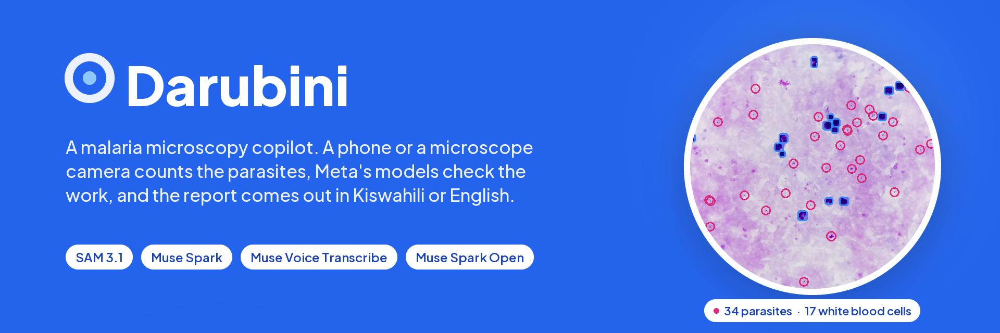
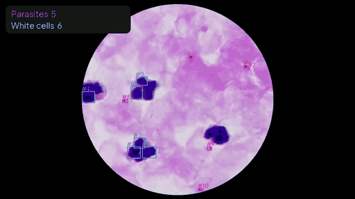
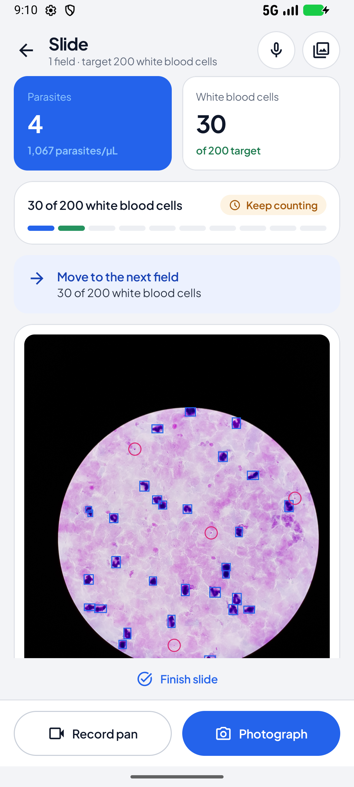
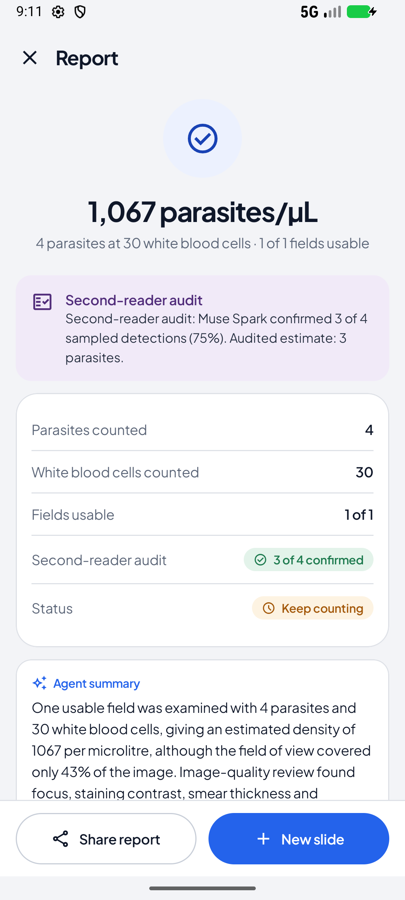
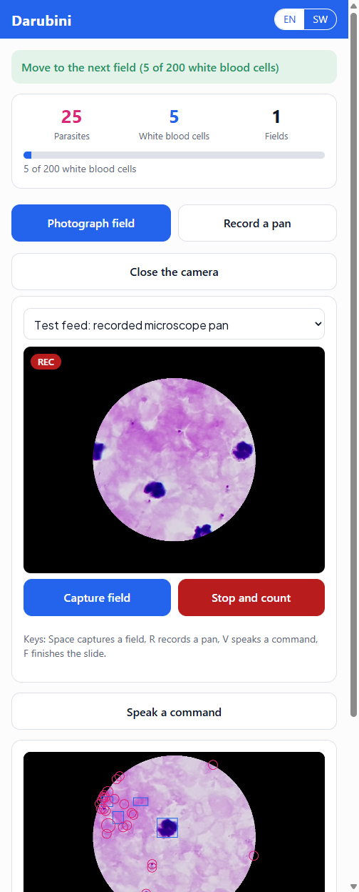
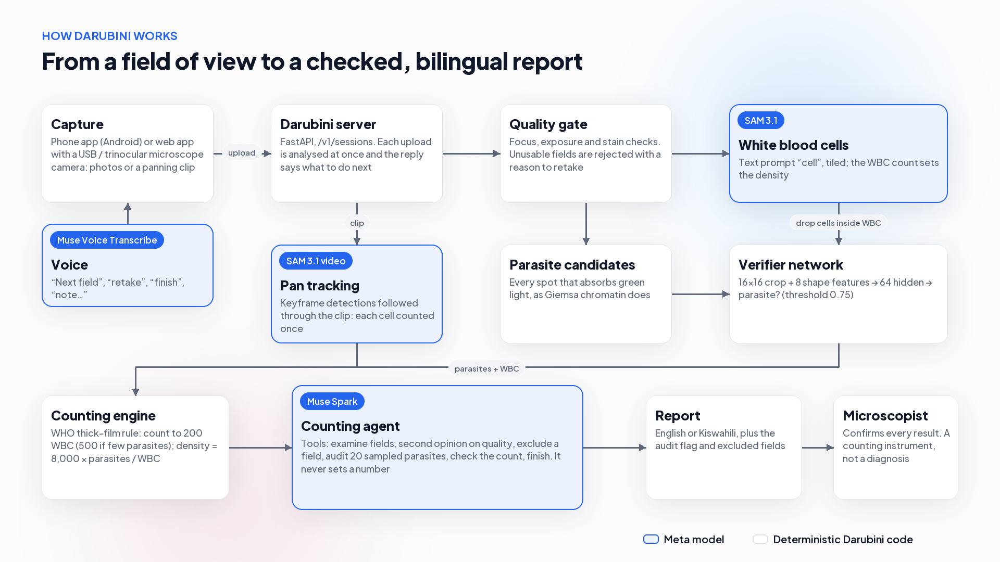
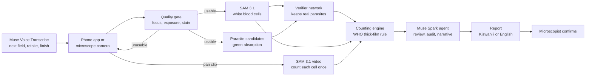
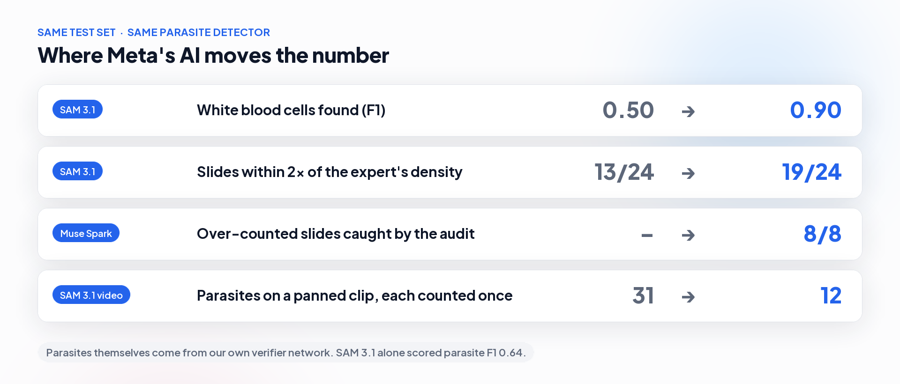
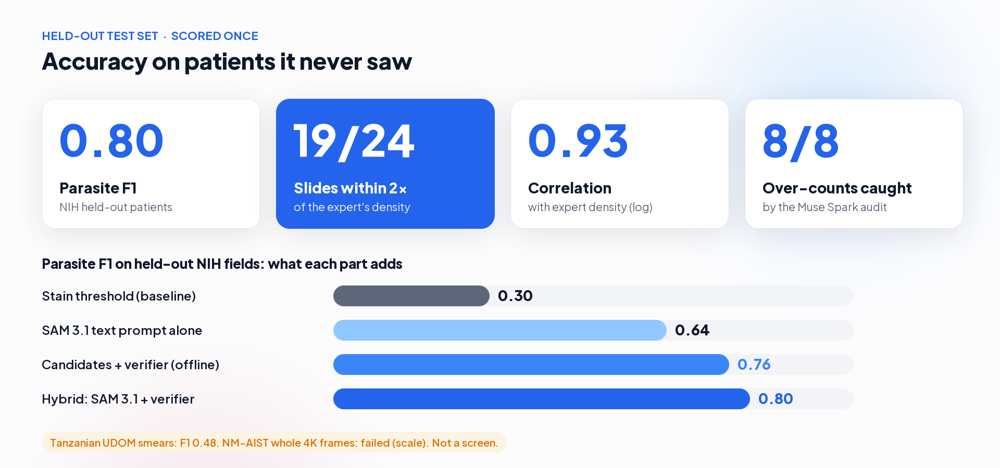
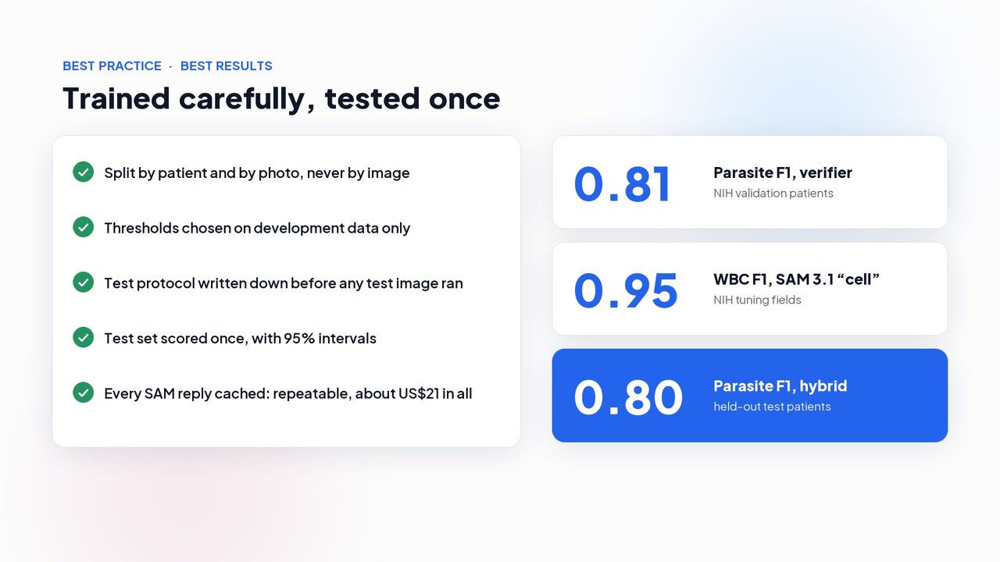

<div align="center">



# Darubini

### Count malaria parasites field by field, check every count, report in Kiswahili or English.

A phone on the eyepiece, or a camera on the microscope, turns an ordinary lab microscope into a counting copilot.
Meta's **SAM 3.1** finds and tracks the cells, **Muse Spark** runs and audits the count, and **Muse Voice Transcribe** keeps the technician's hands on the microscope.

[](https://github.com/albertmwangwa/darubini/actions/workflows/ci.yml)
[](https://github.com/albertmwangwa/darubini/actions/workflows/codeql.yml)


<br>


**[See it work](#see-it-work)** · **[How it works](#how-it-works)** · **[Where Meta's AI matters](#where-metas-ai-moves-the-number)** · **[Results](#results)** · **[Quick start](#quick-start)** · **[Demo video](#demo-video)** · **[Model card](MODEL_CARD.md)**

<sub>*Darubini* is Kiswahili for a magnifying scope. Built for the Meta Global AI Developer Hackathon 2026, Indie track. What was built during the event: [docs/HACKATHON.md](docs/HACKATHON.md).</sub>

</div>

> [!IMPORTANT]
> Darubini is a **counting instrument for trained laboratory staff, not a diagnostic device.** A qualified microscopist confirms every result. It has not been clinically validated.

## See it work

<div align="center">

<br>
<sub>SAM 3.1 video tracking on a panned field (NIH development data): each cell is numbered once as it enters view, so the pan counts <b>12</b> parasites where counting every frame gives <b>31</b>.</sub>
</div>
<br>

<table>
<tr>
<td width="33%" align="center"></td>
<td width="33%" align="center"></td>
<td width="33%" align="center"></td>
</tr>
<tr>
<td align="center"><b>Phone app</b><br><sub>Capture a field; parasites and white cells marked</sub></td>
<td align="center"><b>Phone app</b><br><sub>The Muse Spark report and its audit</sub></td>
<td align="center"><b>Web app + microscope camera</b><br><sub>Live preview; Space captures, R records a pan</sub></td>
</tr>
</table>

## At a glance

| | |
| --- | --- |
| **The problem** | Malaria density is still counted by eye: parasites against 200 white blood cells, field after field. It is slow and tiring, and two microscopists can disagree. |
| **What Darubini does** | Captures fields from a phone or a microscope camera and rejects blurry ones. It detects parasites and white blood cells and applies the WHO counting rule, then a Muse Spark agent audits the count and writes the report. Each field comes back in a few seconds. |
| **How well, on patients it never saw** | Parasite F1 **0.80**; density within 2× of the expert on **19 of 24** slides (*r* = **0.93**); the audit caught **8 of 8** over-counted slides. |
| **What Meta's AI changes** | SAM 3.1's white blood cell count lifts slides within 2× of the expert from **13 to 19 of 24**. Our own verifier finds the parasites. [Details below.](#where-metas-ai-moves-the-number) |
| **What it is not** | Not a screen (uninfected slides show false positives), not a diagnosis, and weaker on Tanzanian UDOM smears (F1 0.48). |

## Why this matters

- WHO estimates **282 million malaria cases and 610,000 deaths in 2024**, with 11 African countries accounting for about two-thirds of both ([World Malaria Report 2025](https://www.who.int/teams/global-malaria-programme/reports/world-malaria-report-2025)).
- **Tanzania ranks fourth worldwide for malaria deaths, with 4.3% of the global total in 2024** ([The Citizen, citing the World Malaria Report 2025](https://www.thecitizen.co.tz/tanzania/news/national/tanzania-among-four-countries-with-highest-malaria-deaths-globally-5433286)).
- Light microscopy of Giemsa-stained thick blood films is still the reference method for confirming malaria and measuring **parasite density**, which guides severity assessment and treatment follow-up.
- Counting is slow, tiring and depends on scarce, well-trained microscopists. Quality varies with fatigue, stain and smear thickness.

Darubini keeps the microscopist in charge and takes the tedious counting off their hands.

## How it works



1. **Capture.** Photograph one field at a time, or record a short clip while panning the slide, from the phone app or from a browser connected to a microscope camera. Say "next field", "retake" or "finish" instead of tapping.
2. **Quality gate.** Fast checks for focus, exposure and staining reject unusable fields and say why, as a careful technician would.
3. **Detect.**
   - SAM 3.1 finds the white blood cells from the single word "cell".
   - Parasites start as high-recall candidates: spots that absorb green light, as Giemsa-stained chromatin does. A small verifier network keeps the real ones.
4. **Count once.** On a panning clip, SAM 3.1 video tracking follows each object, so a cell seen in many frames is counted once.
5. **Apply the WHO rule.** Count against 200 white blood cells, or 500 when parasites are few, and convert to **parasites per µL**. Every threshold is configurable.
6. **Agent, audit and report.**
   - A Muse Spark agent runs the slide through deterministic tools. It reviews doubtful fields, excludes unusable ones with a reason, and audits a random sample of its own detections before it may finish.
   - It writes the narrative in **Kiswahili or English**.
   - It never sets a number: a narrative that quotes a number the tools did not return is dropped.
7. **Hand back.** Excluded fields, the audit result and any spoken notes go to the microscopist to confirm.

<details>
<summary>The same pipeline as a Mermaid diagram</summary>



</details>

## Where Meta's AI moves the number



The plain answer, from the frozen NIH test (24 infected patients, 270 fields):
- **Our own verifier network finds the parasites**, not a Meta model. SAM 3.1's text prompt alone scored parasite F1 0.64. Adding SAM 3.1 box confirmation on top of the verifier added about 0.01 F1 on development data.
- **SAM 3.1 finding the white blood cells is what makes the density right.** Density is 8,000 × parasites ÷ white blood cells, so an inflated white-cell count shrinks every density.

The table compares the same parasite detector with white blood cells found two ways: by offline stain blobs, and by SAM 3.1's "cell" prompt.

| Measure, held-out NIH test | Offline (stain blobs) | With SAM 3.1 | Change |
| --- | ---: | ---: | --- |
| White blood cell F1 | 0.50 | **0.90** | precision 0.35 → 0.87 |
| White blood cell count error per field | +31.0 | **+1.4** | fields hold about 20 labelled white cells, so stain blobs report about 2.5× too many |
| Median slide density, predicted ÷ expert | 0.64× | **1.02×** | from a third too low to on target |
| Slides within ±25% of the expert | 6 / 24 | **11 / 24** | |
| Slides within 2× of the expert | 13 / 24 | **19 / 24** | |
| Correlation with expert density (log) | 0.79 | **0.93** | |
| Parasite F1 | 0.76 | **0.80** | candidates inside a white cell are dropped, so better white-cell boxes keep more real parasites |

The other Meta models move different numbers:
- **Muse Spark's audit** flagged all 8 test slides that were over-counted by 1.5× or more. It also flagged all 7 uninfected slides and 5 of the 16 slides counted correctly, so it is a review trigger, not a verdict.
- **SAM 3.1 video tracking** counted 12 unique parasites on a 90-frame pan, where counting every frame gives 31, with no object counted twice across frames against the expert labels ([tracking_demo.json](docs/demo/tracking_demo.json)).

### Every Meta model, and how far it is proven

| Meta model | Role in Darubini | Status | Called in |
| --- | --- | --- | --- |
| **SAM 3.1** `sam-3.1`, images | Finds white blood cells from the text concept "cell", with prompt wording and tiling tuned by a cached, cost-guarded sweep | **Measured on the held-out test** (table above) | [`segmentation/sam.py`](src/darubini/segmentation/sam.py) |
| **SAM 3.1** `sam-3.1`, video | Counts each object once across a panning clip: box prompts on keyframe detections, followed through the clip | **Measured on a demo pan:** 31 → 12, no duplicates; real phone video untested | [`tracking.py`](src/darubini/tracking.py) |
| **SAM 3.1** `sam-3.1`, box prompts | Optional two-stage detection (`confirmed` mode): SAM 3.1 confirms our candidates, 16 boxes per request | **Measured, small:** about +0.01 F1 on development data ([two_stage.md](docs/calibration/two_stage.md)) | [`segmentation/confirm.py`](src/darubini/segmentation/confirm.py) |
| **Muse Spark** `muse-spark-1.3` | Tool-calling counting agent, image-quality second reader, audit of 20 sampled detections, bilingual narrative | **Measured on the held-out test:** ran 31 of 31 slides unattended; caught 8 of 8 over-counts | [`agent.py`](src/darubini/agent.py), [`audit.py`](src/darubini/audit.py), [`meta/reviewer.py`](src/darubini/meta/reviewer.py) |
| **Muse Voice Transcribe** `muse-voice-transcribe-1.0` | Hands-free capture ("next field", "retake", "finish", "note …"). Any recording is converted to 16 kHz WAV, and spoken notes go into the report | **Verified live in English;** Kiswahili is not on its language list and is unconfirmed | [`voice.py`](src/darubini/voice.py) |
| **Muse Spark Open** (open weights) | Report narrative from any OpenAI-compatible host, for clinics off the Meta API; invented numbers are rejected | **Wired, not run live:** tested against a mock host, because no partner key was available | [`cli.py`](src/darubini/cli.py) |

All Meta Model API calls go through one adapter, [`src/darubini/meta/client.py`](src/darubini/meta/client.py). SAM replies are cached on disk, so an image and prompt are never billed twice. The whole project used about US$21 of API credit.

## Results



The headline question: **does Darubini's count agree with an expert's on slides it never saw?**

The protocol was written down before any test image was run, and the frozen test sets were scored **once**, on 2 Nov 2026:
- 24 infected and 7 uninfected NIH test patients;
- 30% of the UDOM Tanzanian photos;
- 800 NM-AIST Tanzanian images.

Detections are matched to expert labels by their centres.

| Variant | Parasite F1, NIH / UDOM | WBC F1, NIH | Slide density within 2× of expert |
| --- | --- | --- | --- |
| Baseline (stain threshold) | 0.30 / 0.28 | 0.50 | – |
| SAM 3.1 text prompt alone (sample) | 0.64 / 0.15 | 0.90 | – |
| Candidates + verifier (offline) | 0.76 / 0.48 | 0.50 | 13/24 |
| **Hybrid: SAM 3.1 WBC + candidates + verifier** | **0.80 / 0.48** | **0.90** | **19/24** (median ratio 1.02, *r* = 0.93) |

**What it cannot do (yet):**
- It does not separate infected from uninfected slides: every uninfected slide had false positives.
- Tanzanian UDOM smears are harder (F1 0.48).
- It failed on NM-AIST, whose photos are whole 4K microscope frames where parasites are a few pixels wide.

The full tables with 95% intervals are in [`docs/calibration/final_test.md`](docs/calibration/final_test.md). The protocol and discussion are in [`docs/EVALUATION.md`](docs/EVALUATION.md).

### How it was trained

| Practice | What we did |
| --- | --- |
| **Split by patient, never by image** | NIH: 102 / 24 / 24 patients for train, validation and test. UDOM: 431 / 180 photos for train and test. The frozen lists are in [`docs/splits/`](docs/splits/). |
| **A small, inspectable verifier** | A 16×16 colour crop plus 8 shape features (776 inputs), 64 hidden units, one output. Trained for 40 epochs with Adam on 300 NIH fields and 1,604 UDOM tiles. It ships in [`models/`](models/) as a 0.2 MB `.npz`, with no pickle. |
| **Thresholds from development data only** | Verifier threshold 0.75, chosen on held-out tuning patients. Validation F1 rose from 0.29 (candidates alone) to 0.81. |
| **Test once** | The test protocol was frozen before any test image ran, the test set was scored once, and results are reported with Wilson 95% intervals. |
| **Repeatable and cheap** | Every SAM reply is cached; the whole project used about US$21 of API credit. |

## Quick start

Requires Python 3.10+. The trained verifier ships with the repository, so Darubini runs offline straight after install, with no API key.

```bash
git clone https://github.com/albertmwangwa/darubini.git
cd darubini
make setup                    # venv, dependencies, pre-commit hooks
make serve                    # web app on http://127.0.0.1:8000, API docs at /docs
.venv/bin/darubini analyse field1.jpg field2.jpg --language sw    # or count field photos directly
```

<details>
<summary><b>On Windows</b> (no <code>make</code> needed)</summary>

The quickest route: download [`scripts/setup-darubini.cmd`](scripts/setup-darubini.cmd) into the folder you want (for example `F:\Projects`) and double-click it. It clones the repository, installs everything and downloads the core datasets. Or step by step:

```powershell
git clone https://github.com/albertmwangwa/darubini.git
cd darubini
powershell -ExecutionPolicy Bypass -File scripts\setup.ps1
.venv\Scripts\darubini serve
.venv\Scripts\darubini analyse field1.jpg --language sw
```

</details>

**With a Meta Model API key**, run the full pipeline: SAM 3.1 for white blood cells and tracking, the Muse Spark agent and audit, and voice commands.

```bash
cp .env.example .env    # set META_API_KEY; it already selects DARUBINI_SEGMENTER=hybrid
darubini serve --host 0.0.0.0               # open http://<this-computer's-IP>:8000 from a phone or browser
darubini agent path/to/slide-folder --language sw --transcript agent.json
darubini track pan.mp4                      # or: darubini track field.jpg --synthetic
```

**Docker:** `make docker && docker run -p 8000:8000 --env-file .env darubini:local`

### Detection modes

Set the mode with `DARUBINI_SEGMENTER` in `.env`.

| Mode | Parasites | White blood cells | API key | Use it for |
| --- | --- | --- | :---: | --- |
| `verified` *(default)* | Candidates + verifier | Stain blobs | – | Offline counting; parasite F1 0.76 on test |
| **`hybrid`** *(recommended)* | Candidates + verifier | **SAM 3.1** | ✓ | The best results: density within 2× on 19 of 24 slides |
| `confirmed` | Hybrid, plus SAM 3.1 box confirmation | SAM 3.1 | ✓ | Experiments (about +0.01 F1) |
| `sam3` | SAM 3.1 text prompts | SAM 3.1 | ✓ | Ablations only |
| `baseline` | Stain blobs | Stain blobs | – | Debugging; the weakest |

### Using it

**Web app** (`darubini serve`, then open the address):
- With a **microscope camera** (a USB eyepiece camera or a trinocular-port camera), choose **Use a microscope camera**, pick it, and press **Space** for each field. **R** records a pan, **V** speaks a command and **F** finishes.
- On a **phone**, photograph a field through the eyepiece, or record a short clip while panning.
- Each capture comes back in a few seconds with parasites and white blood cells marked, the running count and the next step. **Finish slide** runs the Muse Spark agent; its tool calls appear live, then the report.
- Browsers allow the camera and microphone only on `localhost` or over HTTPS. A laptop running `darubini serve` with its own browser works as is.

**Android app**: [android/](android/) is the same flow in Kotlin and Jetpack Compose, with voice commands. Build it with `cd android && ./gradlew :app:assembleDebug`, then set the server address in its Settings ([android/README.md](android/README.md)).

> **Does it have to be a phone?** No. The phone is the low-cost route for labs that only have a microscope. A camera on the microscope gives steadier, more consistent images, and everything can run on one laptop.

### API

The phone app and the web app use the same API. Interactive docs are at `/docs`.

| Endpoint | What it does |
| --- | --- |
| `POST /v1/sessions` | Start a slide |
| `POST /v1/sessions/{id}/fields` | Send one field photo: detections, running count, and the next step (retake, next field or finish) |
| `POST /v1/sessions/{id}/clips` | Send a panning clip (MP4 or WebM): each cell counted once |
| `POST /v1/sessions/{id}/voice` | Send a recording: the transcript, the command, and any note |
| `POST /v1/sessions/{id}/report` · `GET` | Start the Muse Spark agent; poll its tool calls and the report |
| `GET /v1/sessions/{id}` | The running count |
| `POST /v1/analyse` | Batch: several field images in, one report out |
| `GET /health` | Status and the active detection mode |

## Demo video

<a href="docs/demo/"></a>

A 3-minute demo in two cuts: music only, and with a narrator. It covers the problem, the app, two-stage detection, tracking, training, the agent, the held-out results and the roadmap, built entirely from real project output. It is rendered by [`scripts/demo_video.py`](scripts/demo_video.py). The script, sources and credits are in [`docs/demo/`](docs/demo/).

## Roadmap

- [x] Counting engine, quality gate, bilingual report, API, CLI, CI quality gates
- [x] Meta Model API: SAM 3.1 sweeps with a response cache, box confirmation and video tracking
- [x] Parasite candidates + verifier, adapted to Tanzanian (UDOM) smears
- [x] Muse Spark tool-calling agent with a parasite audit; Muse Voice Transcribe commands
- [x] Web app with a live microscope camera; native Android app
- [x] Final evaluation on the frozen test sets (scored once, 2 Nov); 3-minute demo video
- [ ] Better Tanzanian accuracy; a negative/positive screen that copes with false positives
- [ ] **More of Africa's microscopy:**
  - tuberculosis sputum smears (Ziehl–Neelsen)
  - schistosome eggs in urine
  - trypanosomes in blood
  - soil-transmitted helminth eggs (Kato-Katz)
  - simulated TB cultures, to train colony counting

The hackathon plan is in [`docs/IMPLEMENTATION_PLAN.md`](docs/IMPLEMENTATION_PLAN.md), the build log in [`docs/STATUS.md`](docs/STATUS.md), and the proposal in [`docs/proposal/`](docs/proposal/).

## Responsible AI

- **Human in the loop by design.** Darubini counts and flags; a microscopist decides. Reports say so in both languages.
- **Numbers are deterministic.** Muse Spark only writes narrative around computed figures, and it is instructed never to change them or give treatment advice.
- **Honest uncertainty.** Blocked and doubtful fields are surfaced, not hidden, and the failures are published next to the successes.
- **Privacy.** Field images contain no patient identifiers, and the API stores nothing by default.
- **Known limits** are in [`MODEL_CARD.md`](MODEL_CARD.md):
  - thick films and *P. falciparum* first
  - Giemsa stain only
  - image quality varies with the phone and the adapter

## Reference

<details>
<summary><b>Datasets</b>: eight sources, fetched by one command</summary>

Images are **never committed**. The manifest at [`datasets/manifest.yaml`](datasets/manifest.yaml) lists every source:

```bash
make datasets       # list everything with size, tier and source
make data           # core tier, about 6.5 GB, into datasets/raw/
make data-extended  # adds NM-AIST Tanzania (via Kaggle), thin-smear and species sets
.venv/bin/darubini download --tier large --accept-licences   # after reading the two licences
.venv/bin/darubini verify   # ready / partial / missing for every dataset
.venv/bin/darubini links    # check every source is still online (also runs weekly in CI)
```

Downloads behave carefully:
- They check free disk space first and resume after interruptions.
- They verify MD5 checksums where the provider publishes them.
- If one source fails, they keep going and summarise at the end.

| ID | Origin | Smear | Labels | Size | Tier | Role |
| --- | --- | --- | --- | --- | --- | --- |
| `udom-tz-thick` | **Tanzania** (Morogoro), University of Dodoma | Thick, Giemsa | Boxes: parasites + WBC (VOC) | 149 MB | core | **Tanzanian count benchmark** |
| `nih-thick-pf-150` | Bangladesh, U.S. NLM | Thick, Giemsa | Points per parasite + WBC | 3.9 GB | core | Main training and count set |
| `nih-thick-uninfected` | Bangladesh, U.S. NLM | Thick, Giemsa | WBC; negative slides | 2.5 GB | core | Specificity, negative rule |
| `nm-aist-tz` | **Tanzania** (Arusha), NM-AIST | Thick + thin | Image-level, 3,544 images | ~GBs | extended (Kaggle CLI) | Out-of-distribution slide test |
| `nih-thin-cells` | Bangladesh, U.S. NLM | Thin | Cell crops | 353 MB | extended | Thin-smear stretch goal |
| `mp-idb` | Italy, Univ. of Cagliari | Thin | Masks, 4 species | small | extended | Species and stage stretch goal |
| `colombia-ins-thick` | Colombia, INS | Thick, Romanowsky | 6,188 parasites by stage | 8 GB | large (licence check) | Stain robustness |
| `nlm-sudan` | Sudan, U.S. NLM | Thick + thin | Expert counts, 190 patients | 49 GB | large (licence agreement) | African patient-level validation |

Full details, licences and citations are in [`datasets/README.md`](datasets/README.md).

</details>

<details>
<summary><b>Modules</b>: what each part of <code>src/darubini</code> does</summary>

| Module | Responsibility |
| --- | --- |
| `darubini.quality` | Focus (Laplacian variance at a fixed 1,024 px scale), exposure and Giemsa stain-fraction checks; `darubini.calibration` sets the focus floor from real fields |
| `darubini.segmentation` | `Segmenter` protocol and factory (`baseline`, `verified`, `sam3`, `hybrid`, `confirmed`); green-absorption parasite candidates; SAM 3.1, tiled; SAM 3.1 box confirmation |
| `darubini.verifier` | Parasite verifier: a small NumPy network that keeps real parasites among the candidates |
| `darubini.counting` | Parasite density, the configurable WHO-style stopping rule, slide status |
| `darubini.report` | Deterministic English and Kiswahili reports, the source of truth for numbers |
| `darubini.meta` | Meta Model API client (SAM 3.1 images, boxes and video; Muse Spark chat and tools; Muse Voice Transcribe) and the Muse Spark reviewer |
| `darubini.agent`, `darubini.audit` | Muse Spark counting agent with guardrails; second-reader audit of parasite detections |
| `darubini.voice` | Voice commands: any recorded audio to 16 kHz WAV, transcription, command and note parsing in English and Kiswahili |
| `darubini.tracking`, `darubini.video` | Count each object once across a panning clip (SAM 3.1 video, or an offline shift tracker); MP4 and WebM decoding with PyAV |
| `darubini.data` | Dataset manifest, resumable checksum-verified downloads, annotation parsers, frozen splits |
| `darubini.evaluation`, `darubini.benchmark`, `darubini.sweep` | Detection and count metrics, whole-segmenter scoring on labelled splits, SAM prompt and tiling sweeps with a cost guard |
| `darubini.api` | FastAPI service: the web app at `/`, capture sessions at `/v1/sessions`, batch `POST /v1/analyse`, OpenAPI docs at `/docs` |
| `darubini.cli` | `darubini datasets`, `download`, `verify`, `profile`, `splits`, `links`, `calibrate`, `sweep`, `train-verifier`, `evaluate`, `analyse`, `agent`, `track`, `serve` |

</details>

<details>
<summary><b>Engineering and quality</b>: the checks every push runs</summary>

| Gate | Tool | Bar |
| --- | --- | --- |
| Lint and format | Ruff (pycodestyle, pyflakes, isort, bugbear, docstrings, security rules) | zero findings |
| Types | mypy `--strict` | zero errors |
| Tests | pytest on Python 3.10, 3.11, 3.12 | all pass, **coverage ≥ 80%** (currently 97%, 220 tests) |
| Security | Bandit, pip-audit, CodeQL | no findings, no known-vulnerable dependencies |
| Container | Docker multi-stage build, non-root user, health check | builds |
| Dependencies | Dependabot (pip, Actions, Docker) | weekly |

Pre-commit hooks run the same checks locally and block large files and private keys from being committed. Run everything CI runs with `make check`.

</details>

<details>
<summary><b>Project layout</b></summary>

```
darubini/
├── src/darubini/
│   ├── api/              # FastAPI service and the web app (static/index.html)
│   ├── data/             # manifest, downloader, annotation parsers, splits
│   ├── meta/             # Meta Model API client, Muse Spark reviewer
│   ├── segmentation/     # detectors: baseline, candidates, SAM 3.1, box confirmation
│   ├── agent.py audit.py # Muse Spark counting agent and audit
│   ├── tracking.py       # count once across a panning clip
│   ├── voice.py          # voice commands
│   ├── counting.py       # WHO-style thick-film counting
│   ├── quality.py        # field quality checks
│   ├── report.py         # en / sw reports
│   └── cli.py
├── android/              # native Android app (Kotlin, Jetpack Compose)
├── models/               # the trained parasite verifier (0.2 MB)
├── scripts/              # final evaluation, demo video, README art, setup
├── tests/                # pytest suite with synthetic smear fields
├── datasets/             # manifest.yaml + README; raw/ and processed/ are git-ignored
├── docs/                 # status, evaluation, calibration reports, splits, demo, proposal
├── MODEL_CARD.md
├── Dockerfile
└── Makefile
```

</details>

## Acknowledgements and citations

This work stands on openly shared data. Please cite the original authors when using it:

- Shaka M. et al., *Malaria Blood Smear Image Dataset*, University of Dodoma and Benjamin Mkapa Hospital, Zenodo, 2020. doi:10.5281/zenodo.4314960
- Yang F., Poostchi M., Yu H. et al., *Deep Learning for Smartphone-based Malaria Parasite Detection in Thick Blood Smears*, IEEE JBHI 24(5), 2020. doi:10.1109/JBHI.2019.2939121
- *Blood smear imagery dataset for malaria parasite detection: A case of Tanzania*, Data in Brief, 2024 (NM-AIST).
- Loddo A. et al., *MP-IDB: The Malaria Parasite Image Database*, 2018.
- Yu H. et al., *Patient-level performance evaluation of a smartphone-based malaria diagnostic application*, Malaria Journal, 2023.
- Carion N. et al., *SAM 3: Segment Anything with Concepts*, Meta, 2025. arXiv:2511.16719
- World Health Organization, *Basic Malaria Microscopy*, 2nd ed., 2010; *World Malaria Report 2025*.

The README images are drawn by [`scripts/readme_art.py`](scripts/readme_art.py) from real project data. The tracking animation is the real SAM 3.1 output from [`scripts/tracking_demo.py`](scripts/tracking_demo.py).

## Author

**Albert William Mwangwa**, MSc Data Science candidate, University of Dar es Salaam · [GitHub](https://github.com/albertmwangwa)

## License

Code: [MIT](LICENSE). Datasets keep their own licences; see [`datasets/README.md`](datasets/README.md).
