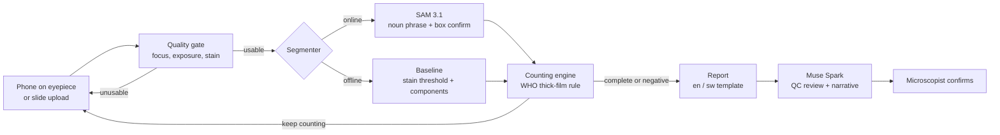

<div align="center">

# Darubini

**A malaria microscopy copilot built on Meta SAM 3.1 and Muse Spark.**
A phone on a microscope eyepiece, a count a microscopist can trust, a report in Kiswahili or English.

[](https://github.com/albertmwangwa/darubini/actions/workflows/ci.yml)
[](https://github.com/albertmwangwa/darubini/actions/workflows/codeql.yml)


*Darubini is Kiswahili for a magnifying scope. Built for the Meta Global AI Developer Hackathon 2026, Indie track.*

</div>

> [!IMPORTANT]
> Darubini is a **counting instrument for trained laboratory staff**. It gives no diagnosis, no medical advice and no treatment guidance: it counts what is on the slide and a qualified microscopist decides. It has not been clinically validated.

> [!NOTE]
> **Hackathon provenance.** Everything up to commit [`9c8d6b4`](https://github.com/albertmwangwa/darubini/commit/9c8d6b4) (25 Oct 2026) was written **before** the building period: scaffolding, CI, dataset tooling and an offline baseline, with no Meta model called. Work built during the hackathon (27 Oct to 4 Nov 2026) is [everything after it](https://github.com/albertmwangwa/darubini/compare/9c8d6b4...main). Details: [`docs/HACKATHON.md`](docs/HACKATHON.md).

---

## Contents

- [Why this matters](#why-this-matters)
- [What Darubini does](#what-darubini-does)
- [How it uses Meta AI](#how-it-uses-meta-ai)
- [Architecture](#architecture)
- [Quick start](#quick-start)
- [Datasets](#datasets)
- [Evaluation plan](#evaluation-plan)
- [Engineering and quality](#engineering-and-quality)
- [Project layout](#project-layout)
- [Roadmap](#roadmap)
- [Responsible AI](#responsible-ai)
- [Acknowledgements and citations](#acknowledgements-and-citations)

## Why this matters

- WHO estimates **282 million malaria cases and 610,000 deaths in 2024**, with 11 African countries accounting for about two-thirds of both ([World Malaria Report 2025](https://www.who.int/teams/global-malaria-programme/reports/world-malaria-report-2025)).
- **Tanzania ranks fourth worldwide for malaria deaths, with 4.3% of the global total in 2024** ([The Citizen, citing the World Malaria Report 2025](https://www.thecitizen.co.tz/tanzania/news/national/tanzania-among-four-countries-with-highest-malaria-deaths-globally-5433286)).
- Light microscopy of Giemsa-stained thick blood films remains the reference method for confirming malaria and measuring **parasite density**, which guides severity assessment and treatment follow-up. Counting is slow, tiring and depends on scarce, well-trained microscopists. Quality varies with fatigue, stain and smear thickness.

Darubini keeps the microscopist in charge and takes the tedious counting off their hands.

## What Darubini does

1. **Capture.** A phone held to the eyepiece photographs one microscope field at a time (or a slide image is uploaded).
2. **Quality gate.** Fast checks for focus, exposure and staining reject unusable fields and ask for another, as a careful technician would.
3. **Segment.** SAM 3.1 finds every parasite and white blood cell (WBC) from noun-phrase prompts; candidates from the offline detector are confirmed with SAM 3.1 box prompts.
4. **Count.** Parasites are counted against WBC and converted to **parasites per microlitre** using the procedure taught in WHO *Basic Malaria Microscopy*: count against 200 WBC, extend to 500 WBC when few parasites are seen, and declare a slide negative only after enough clean fields. Every threshold is configurable.
5. **Review and report.** Muse Spark acts as a second reader for image quality and writes a short report in **Kiswahili or English** around numbers the pipeline computed. The model never changes a number.
6. **Hand back.** Uncertain fields are flagged for the microscopist to confirm.

```text
Fields examined: 14 (13 usable)
Parasites counted: 31
White blood cells counted: 206
Estimated density: 1,204 parasites/µL
Status: Count complete

Decision-support estimate only. A qualified microscopist must confirm this result before any clinical use.
```

<sub>Example output format with illustrative numbers. Real evaluation results will appear in [docs/EVALUATION.md](docs/EVALUATION.md).</sub>

## How it uses Meta AI

| Meta tool | Role in Darubini | Beyond a basic call |
| --- | --- | --- |
| **SAM 3.1** (`sam-3.1`, promptable segmentation) | Finds parasites and WBC nuclei from noun phrases | Two-stage detection: the offline detector proposes candidates and SAM 3.1 box prompts confirm or reject each one; video tracking across a panning eyepiece stream so one parasite is counted once |
| **Muse Spark** (`muse-spark-1.3`, multimodal reasoning) | Field quality second reader; bilingual report writer | Tool-calling agent with structured output that drives the counting engine, decides when to move to the next field, and explains disagreements between SAM 3.1 and the baseline |
| **Muse Voice Transcribe** | Hands-free control at the microscope | The technician says "next field" or dictates a note in Kiswahili while both hands are on the stage |
| **Meta open-weights models** (via partner inference) | Offline Kiswahili report drafting | Path to a low-connectivity clinic deployment |
| **Muse Glimmer / Muse Spark Open** (open weights) | Offline report drafting | Runs through partner inference; the path to clinics with unreliable internet |
| **Muse Code** | Pair-programming during the build | Generates test scaffolds and evaluation scripts |

All calls go through the OpenAI-compatible Meta Model API at `https://api.meta.ai/v1`; SAM 3.1 output is decoded with Meta's official `meta_sam_parser`.

All Meta Model API calls sit behind one adapter, [`src/darubini/meta/client.py`](src/darubini/meta/client.py). Routes and payload fields are wired to the official docs at kickoff, with no other code changes needed.

## Architecture



| Module | Responsibility |
| --- | --- |
| `darubini.quality` | Laplacian-variance focus, exposure and Giemsa stain-fraction checks |
| `darubini.segmentation` | `Segmenter` protocol; `BaselineSegmenter` (offline) and `SamSegmenter` (SAM 3.1) |
| `darubini.counting` | Parasite density, configurable WHO-style stopping rule, slide status |
| `darubini.report` | Deterministic English and Kiswahili reports (the source of truth for numbers) |
| `darubini.meta` | Meta Model API client and the Muse Spark reviewer |
| `darubini.data` | Dataset manifest, resumable checksum-verified downloads, annotation parsers |
| `darubini.evaluation` | Detection precision/recall/F1, count MAE and bias, slide sensitivity/specificity |
| `darubini.api` | FastAPI service (`POST /v1/analyse`, `GET /health`, OpenAPI docs at `/docs`) |
| `darubini.cli` | `darubini datasets`, `download`, `verify`, `links`, `analyse`, `serve` |

## Quick start

Requires Python 3.10+ and `make`.

```bash
git clone https://github.com/albertmwangwa/darubini.git
cd darubini
make setup          # venv, dev dependencies, pre-commit hooks
make check          # lint, types, security, tests: everything CI runs
```

On **Windows**, the quickest route is to download [`scripts/setup-darubini.cmd`](scripts/setup-darubini.cmd) into the folder you want (for example `F:\Projects`) and double-click it: it clones the repo, installs everything and downloads the core datasets. Or step by step (no `make` needed):

```powershell
git clone https://github.com/albertmwangwa/darubini.git
cd darubini
powershell -ExecutionPolicy Bypass -File scripts\setup.ps1
powershell -ExecutionPolicy Bypass -File scripts\get-data.ps1        # core datasets
```

Try it offline with the baseline segmenter (no API key needed):

```bash
.venv/bin/darubini analyse path/to/field1.jpg path/to/field2.jpg --language sw
make serve          # API on http://127.0.0.1:8000, interactive docs at /docs
```

Switch to SAM 3.1 once you have Meta Model API credits:

```bash
cp .env.example .env    # set META_API_KEY, META_API_BASE_URL, DARUBINI_SEGMENTER=sam3
```

Docker:

```bash
make docker && docker run -p 8000:8000 --env-file .env darubini:local
```

## Datasets

Images are **never committed**. The manifest at [`datasets/manifest.yaml`](datasets/manifest.yaml) lists every source, and one command fetches them with resume support and checksum verification:

```bash
make datasets       # list everything with size, tier and source
make data           # core tier, about 6.5 GB, into datasets/raw/
make data-extended  # adds NM-AIST Tanzania (via Kaggle), thin-smear and species sets
.venv/bin/darubini download --tier large --accept-licences   # after reading the two licences
.venv/bin/darubini verify   # ready / partial / missing for every dataset
.venv/bin/darubini links    # check every source is still online (also runs weekly in CI)
```

Downloads check free disk space first, resume after interruptions, verify MD5 checksums where the provider publishes them, and keep going if one source fails, with a summary at the end.

| ID | Origin | Smear | Labels | Size | Tier | Role |
| --- | --- | --- | --- | --- | --- | --- |
| `udom-tz-thick` | **Tanzania** (Morogoro), University of Dodoma | Thick, Giemsa | Boxes: parasites + WBC (VOC) | 149 MB | core | **Tanzanian count benchmark** |
| `nih-thick-pf-150` | Bangladesh, U.S. NLM | Thick, Giemsa | Points per parasite + WBC | 3.9 GB | core | Main training and count set |
| `nih-thick-uninfected` | Bangladesh, U.S. NLM | Thick, Giemsa | WBC; negative slides | 2.5 GB | core | Specificity, negative rule |
| `nm-aist-tz` | **Tanzania** (Arusha), NM-AIST | Thick + thin | Image-level, 3,544 images | ~GBs | extended (Kaggle CLI) | Out-of-distribution slide test |
| `nih-thin-cells` | Bangladesh, U.S. NLM | Thin | Cell crops | 353 MB | extended | Thin-smear stretch goal |
| `mp-idb` | Italy, Univ. of Cagliari | Thin | Masks, 4 species | small | extended | Species and stage stretch goal |
| `colombia-ins-thick` | Colombia, INS | Thick, Romanowsky | 6,188 parasites by stage | 8 GB | large (licence check) | Stain robustness |
| `nlm-sudan` | Sudan, U.S. NLM | Thick + thin | Expert counts, 190 patients | 49 GB | large (licence agreement) | African patient-level validation |

The **training and test split is by patient**, never by image, so no patient appears on both sides. Full details, licences and citations: [`datasets/README.md`](datasets/README.md).

## Evaluation plan

The headline question: **does Darubini's count agree with an expert's, on slides from Tanzania it never trained on?**

| Metric | Data | Why |
| --- | --- | --- |
| Parasite and WBC detection precision, recall, F1 (IoU ≥ 0.3) | NLM held-out patients, UDOM Tanzania | Are we finding the right objects? |
| Count MAE, mean bias and Pearson *r* per field | UDOM Tanzania (never trained on) | Does the count track the expert? |
| Slide-level sensitivity and specificity | NM-AIST Tanzania, NLM uninfected | Does it call positive and negative slides correctly? |
| Ablations: baseline vs SAM 3.1 noun phrase vs baseline + SAM 3.1 box confirmation | All of the above | Shows exactly what each Meta capability adds |

Method and results: [`docs/EVALUATION.md`](docs/EVALUATION.md).

## Engineering and quality

Every push and pull request runs:

| Gate | Tool | Bar |
| --- | --- | --- |
| Lint and format | Ruff (pycodestyle, pyflakes, isort, bugbear, docstrings, security rules) | zero findings |
| Types | mypy `--strict` | zero errors |
| Tests | pytest on Python 3.10, 3.11, 3.12 | all pass, **coverage ≥ 80%** (currently ~96%) |
| Security | Bandit, pip-audit, CodeQL | no findings, no known-vulnerable dependencies |
| Container | Docker multi-stage build, non-root user, health check | builds |
| Dependencies | Dependabot (pip, Actions, Docker) | weekly |

Pre-commit hooks run the same checks locally and block large files and private keys from being committed.

## Project layout

```
darubini/
├── src/darubini/
│   ├── api/              # FastAPI service
│   ├── data/             # manifest, downloader, annotation parsers
│   ├── meta/             # Meta Model API client, Muse Spark reviewer
│   ├── segmentation/     # Segmenter protocol, baseline, SAM 3.1
│   ├── counting.py       # WHO-style thick-film counting
│   ├── quality.py        # field quality checks
│   ├── report.py         # en / sw reports
│   ├── evaluation.py     # metrics
│   ├── pipeline.py       # end-to-end flow
│   └── cli.py
├── tests/                # pytest suite with synthetic smear fields
├── datasets/             # manifest.yaml + README; raw/ and processed/ are git-ignored
├── docs/                 # implementation plan, architecture, evaluation
├── notebooks/            # exploration (outputs stripped before commit)
├── .github/              # CI, CodeQL, Dependabot, templates
├── MODEL_CARD.md
├── Dockerfile
└── Makefile
```

## Roadmap

The day-by-day hackathon plan is in [`docs/IMPLEMENTATION_PLAN.md`](docs/IMPLEMENTATION_PLAN.md); the proposal is in [`docs/proposal/`](docs/proposal/) as a web page and a PowerPoint deck. In short:

- [x] Repository, CI quality gates, dataset manifest and downloader
- [x] Counting engine, quality gate, baseline segmenter, bilingual report, API, CLI
- [ ] Wire the Meta Model API (Responses API + `meta_sam_parser`); SAM 3.1 noun-phrase run on all core data
- [ ] Two-stage detection (baseline proposals, SAM 3.1 box confirmation) and prompt ablations; publish evaluation tables
- [ ] Muse Spark tool-calling agent for live counting sessions
- [ ] Phone capture web app with mask overlay and running count
- [ ] Live demo on a real microscope in Dar es Salaam; 3-minute video

## Responsible AI

- **Human in the loop by design.** Darubini counts and flags; a microscopist decides. Reports say so in both languages.
- **Numbers are deterministic.** Muse Spark only writes narrative around computed figures and is instructed never to change them or give treatment advice.
- **Honest uncertainty.** Blocked and doubtful fields are surfaced, not hidden.
- **Privacy.** Field images contain no patient identifiers; the API stores nothing by default.
- **Known limits** are tracked in [`MODEL_CARD.md`](MODEL_CARD.md): thick films and *P. falciparum* first, Giemsa stain only, smartphone image quality varies.

## Acknowledgements and citations

This work stands on openly shared data. Please cite the original authors when using it:

- Shaka M. et al., *Malaria Blood Smear Image Dataset*, University of Dodoma and Benjamin Mkapa Hospital, Zenodo, 2020. doi:10.5281/zenodo.4314960
- Yang F., Poostchi M., Yu H. et al., *Deep Learning for Smartphone-based Malaria Parasite Detection in Thick Blood Smears*, IEEE JBHI 24(5), 2020. doi:10.1109/JBHI.2019.2939121
- *Blood smear imagery dataset for malaria parasite detection: A case of Tanzania*, Data in Brief, 2024 (NM-AIST).
- Loddo A. et al., *MP-IDB: The Malaria Parasite Image Database*, 2018.
- Yu H. et al., *Patient-level performance evaluation of a smartphone-based malaria diagnostic application*, Malaria Journal, 2023.
- Carion N. et al., *SAM 3: Segment Anything with Concepts*, Meta, 2025. arXiv:2511.16719
- World Health Organization, *Basic Malaria Microscopy*, 2nd ed., 2010; *World Malaria Report 2025*.

## Author

**Albert William Mwangwa**, MSc Data Science candidate, University of Dar es Salaam · [GitHub](https://github.com/albertmwangwa)

## License

Code: [MIT](LICENSE). Datasets keep their own licences; see [`datasets/README.md`](datasets/README.md).
